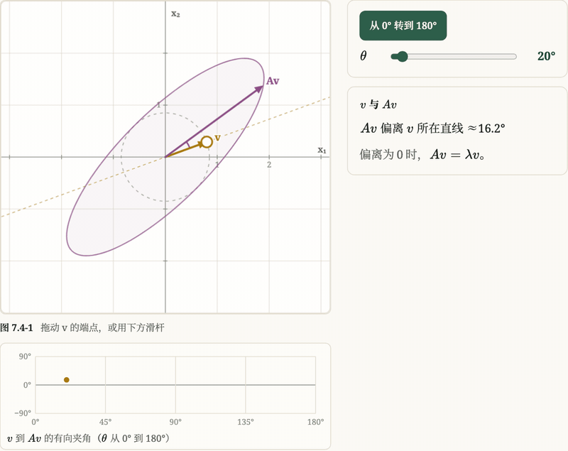
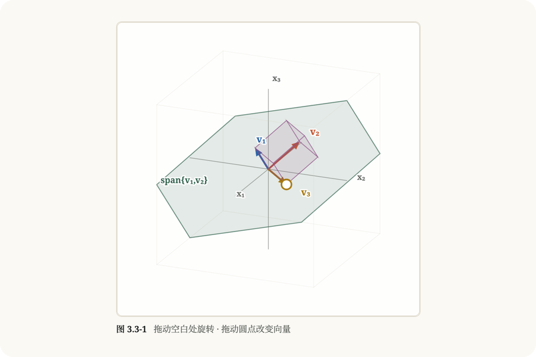
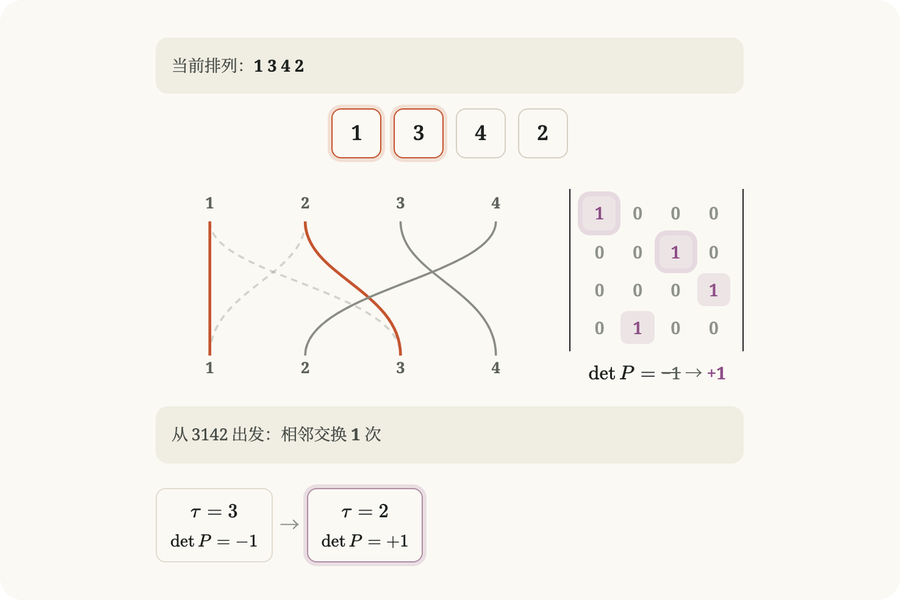
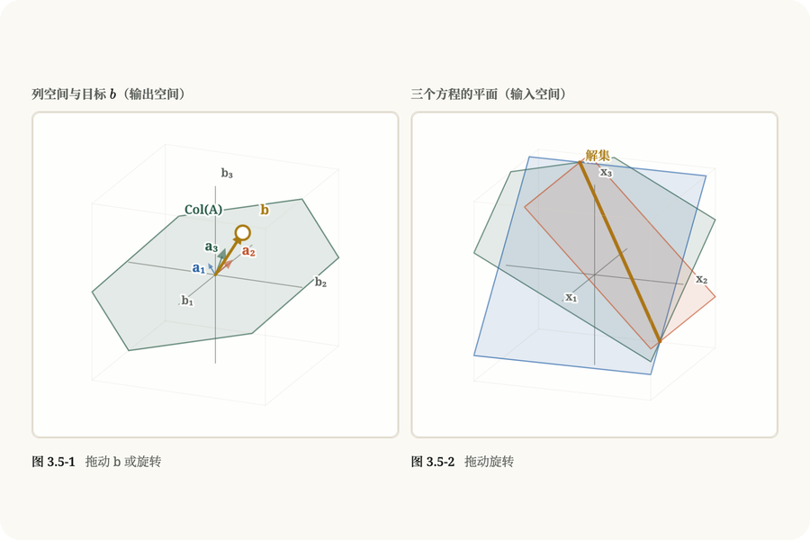
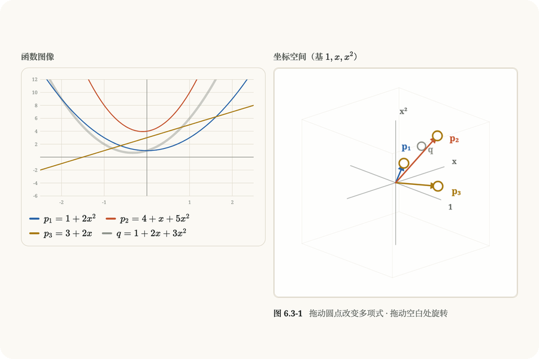
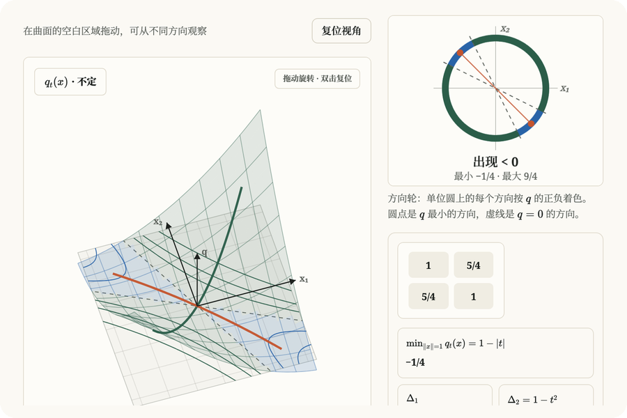
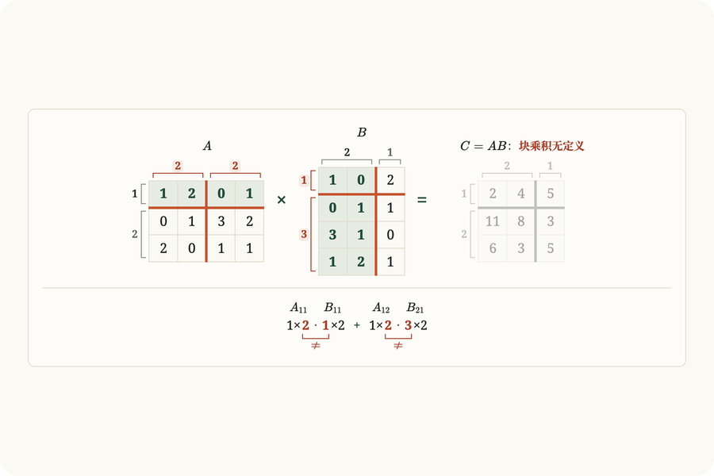
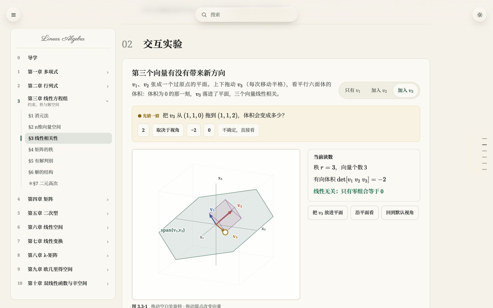
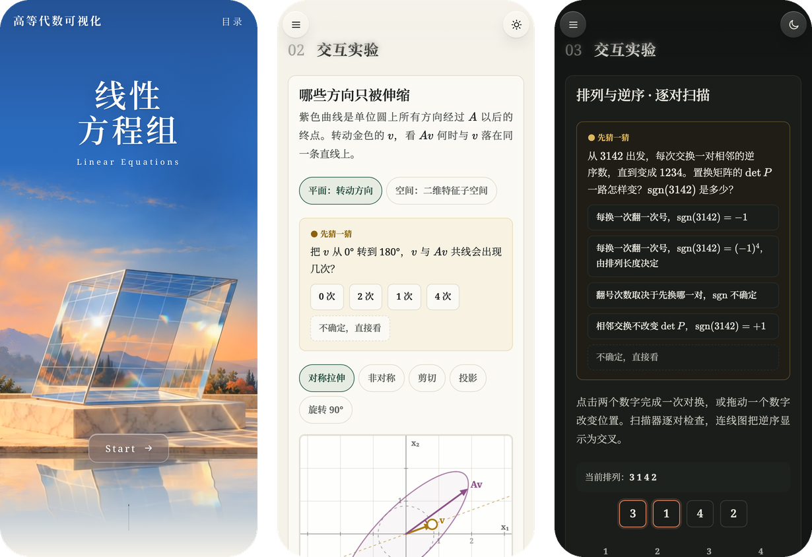

<div align="center">

<a href="https://piaoyaoxi.github.io/linear-algebra-visualization/">
  
</a>

<h1>高等代数可视化</h1>

<p><b>把高等代数里看不见的东西拖出来看。</b></p>

<p>
  按北大版《高等代数》十章七十三节编排 · 51 节带可拖动的实验 · 打开浏览器就能用
</p>

<p>
  <a href="https://piaoyaoxi.github.io/linear-algebra-visualization/"><b>在线访问</b></a>
  &nbsp;·&nbsp;
  <a href="https://piaoyaoxi.github.io/linear-algebra-visualization/learn.html#ch1/number-fields">从第一节开始</a>
  &nbsp;·&nbsp;
  <a href="#在本地跑起来">在本地跑起来</a>
</p>

</div>

<br>

学高等代数的时候，最难的往往不是算，是想象：矩阵乘上去以后整张平面怎么动，三个平面为什么忽然没有公共点，秩掉下来的那一刻到底少了什么。教材写得很严谨，可纸面是静止的；课堂板书能画几笔，画不出连续的变化。

这个网站想补上的就是这一块。每一节只围绕一个问题展开，先让你猜，再让你动手拖，看清楚以后再回到定理和公式。它不打算替代教材，也不是题库，更像放在课本旁边的一张会动的草稿纸。

## 一节课是怎么走的

<p align="center">
  
  <br>
  <sub>第七章 §4 特征值与特征向量：先猜 v 与 Av 共线几次，再让 v 转半圈，下方曲线每次穿过 0°，就找到一个特征方向。</sub>
</p>

每一节都按同一条路走：

**问题 → 先猜一猜 → 动手 → 定理 → 例题 → 自测 → 小结**

- **先猜，后看。** 实验开始前会先问一个具体的问题，比如“把 b 从 (1,2,3) 拉到 (1,2,4)，三个平面会变成什么样”。在你做出选择之前，会直接给出答案的读数和图线都先藏着。
- **动手一次，结论才出现。** 猜完以后要亲手拖一下、点一下，读数和结论随后出现，然后告诉你猜得对不对。
- **例题先藏答案。** 代表例题的题目一直在，解析要你选完再展开；答错了可以再试。
- **判断用精确数。** 秩、有没有解、是否线性相关，全部用有理数精确计算，屏幕上的读数能写成分数就写分数，不会因为浮点误差把 0 说成 0.0000001。

## 实验长什么样

<table>
  <tr>
    <td width="50%" valign="top">
      
      <p><b>第三章 §3 线性相关性</b><br>上下拖动 v₃，看平行六面体的体积。体积变成 0 的那一刻，v₃ 落进了 v₁、v₂ 张成的平面。</p>
    </td>
    <td width="50%" valign="top">
      
      <p><b>第二章 §2 排列</b><br>每交换一对相邻的逆序，连线图里就少一个交叉，置换矩阵的行列式跟着翻一次号。</p>
    </td>
  </tr>
  <tr>
    <td width="50%" valign="top">
      
      <p><b>第三章 §5 有解判别</b><br>左边是列空间和目标 b，右边是三个方程各自的平面。b 一离开列空间，三个平面就失去公共的那条线。</p>
    </td>
    <td width="50%" valign="top">
      
      <p><b>第六章 §3 维数、基与坐标</b><br>每个二次多项式对应空间里的一个点。三条曲线是不是一组基，看三个坐标点是不是和原点共面。</p>
    </td>
  </tr>
  <tr>
    <td width="50%" valign="top">
      
      <p><b>第五章 §4 正定二次型</b><br>把交叉项 t 往右拖，碗形曲面在某一刻翻成马鞍，单位圆上的方向轮跟着出现负的那一段。</p>
    </td>
    <td width="50%" valign="top">
      
      <p><b>第四章 §5 矩阵的分块</b><br>拖动切口，看 A 的列切法和 B 的行切法对不上时，哪一对子块没法相乘。</p>
    </td>
  </tr>
</table>

需要三维才说得清的概念（平面相交、张成、子空间的交与和、不变子空间……）用的是同一个自己写的 3D 场景：正交相机、可以按住旋转、可以一键“沿某个方向看”，拖动点会被约束在该待的平面或直线上。

## 十章内容

| 章 | 节 | 在这一章里可以看到 |
| :-- | :-: | :-- |
| 第一章 多项式 | 11 | 辗转相除时余式的次数一步步往下掉；两个单根并成重根的那一刻，f 和 f′ 开始有公因式 |
| 第二章 行列式 | 8 | 行列式就是有向面积和体积；排列的逆序、按行展开、克拉默法则、Laplace 展开 |
| 第三章 线性方程组 | 7 | 消元时平面绕着交线转、解不变；秩、相关性、解集是零空间平移过去的样子 |
| 第四章 矩阵 | 7 | 矩阵怎样拖动整张网格，乘法为什么是两次变换的复合；逆、分块、初等矩阵 |
| 第五章 二次型 | 4 | 曲面和等高线；换元能扭曲曲面，却改不了向上、向下方向的个数 |
| 第六章 线性空间 | 8 | 基与坐标、基变换、子空间的交与和、直和分解、同构 |
| 第七章 线性变换 | 9 | 特征方向、对角化、值域与核、不变子空间、若尔当形、最小多项式 |
| 第八章 λ-矩阵 | 7 | 化标准形的每一步、不变因子、初等因子，以及若尔当形是怎样推出来的 |
| 第九章 欧几里得空间 | 8 | 内积、施密特正交化、正交变换、实对称矩阵的标准形、最小二乘 |
| 第十章 双线性函数与辛空间 | 4 | 线性函数、对偶空间、双线性函数、辛空间 |

偏符号推导的小节（比如数域、对称多项式）没有硬塞动画，只留导读、例题和自测：动手之后看不到文字给不了的东西，就不做实验。

## 浅色、深色和手机

<picture>
  <source media="(prefers-color-scheme: dark)" srcset="docs/readme/lesson-dark.jpg">
  
</picture>

<sub>上面这张图会跟着你的 GitHub 主题切换浅色或深色。</sub>

页面用的是一套叫“松烟”的配色：正文、公式、例题放在实底的纸色上，只有顶部控件、搜索和菜单这些浮在上面的东西才用半透明的亚克力质感。画布上每种颜色只代表一类对象：蓝色总是第一个向量，金色总是你能拖的那个点，紫色总是变换以后的结果，换一节也不用重新认颜色。

<p align="center">
  
</p>

手机上同样能拖、能转 3D 图；长公式在窄屏上只在等号这类关系符号后面断行，实在放不下的单独成行、横向滚动。

## 在本地跑起来

整个网站是静态页面，没有构建步骤，也不需要装依赖。

```bash
git clone https://github.com/piaoyaoxi/linear-algebra-visualization.git
```

```bash
cd linear-algebra-visualization && python3 .github/scripts/serve.py 8765 current
```

然后打开 <http://localhost:8765/>（首页）或 <http://localhost:8765/learn.html>（课程页）。也可以用别的静态服务器，但不要用 `python3 -m http.server`：它同时只排队 5 个连接，课程页一次请求两百多个文件，在 macOS 上会偶尔漏掉脚本，某一章就打不开。直接双击 HTML 文件也能打开，但浏览器会拦下本地字体，排版会走样。

## 仓库里有什么

```text
current/                 网站本体（部署的就是这个目录）
├── index.html           首页
├── learn.html           课程页
├── app.js               路由、目录、搜索、进度
├── content/             十章的文字、例题和自测，一节一个文件
├── visuals/             各章的实验和画布
│   └── shared/          共用的 3D 场景、预测门、中文排版脚本
├── vendor/katex/        本地 KaTeX
└── vendor/fonts/        裁剪过的衬线字体子集
tests/                   各章的浏览器测试
.github/                 部署、PR 预览和逐节检查的工作流
docs/                    设计规范和各章制作记录
```

## 写这个项目时的几个选择

- **原生 HTML、CSS、JavaScript。** 没有框架，没有打包工具，打开源码就是浏览器实际执行的代码。
- **公式全部用本地 KaTeX 渲染**，不依赖 CDN；按钮、读数、选项里的公式也一样。
- **一套字体走到底。** 中文用思源宋体，西文和希腊字母用 Noto Serif，画布上的标签也用同一套；字体按实际用到的字裁成子集，新加内容时由 CI 检查有没有缺字。
- **中文排版单独处理过。** 段末不留单字，行内公式只在关系符号后面断行，汉字和公式之间留四分之一个字宽，全角标点不会被两端对齐撑开。
- **每个 PR 都会逐节检查。** 工作流把 73 节一节一节打开，检查脚本报错、横向溢出、KaTeX 渲染错误、样式有没有渗进公式、页面上有没有混进内部用语；每个 PR 还会发布一个独立的预览地址。

想参与开发的话，先读 [AGENTS.md](AGENTS.md) 和 [TODO.md](TODO.md)，里面有分支约定和项目现在的进度；视觉上的规定在 [docs/design-spec.md](docs/design-spec.md)。

## 致谢

章节结构取自北大版《高等代数》。讲法和例子参考了 Gilbert Strang 的 *Introduction to Linear Algebra*、David Lay 的 *Linear Algebra and Its Applications*、Sheldon Axler 的 *Linear Algebra Done Right* 和《线性代数不难》；“先让一个对象连续变形，再把图像落回公式”的叙事方式，很大程度上学自 3Blue1Brown 的 *Essence of Linear Algebra*。网站里所有的图和动画都是重新画的。

公式渲染用的是 [KaTeX](https://katex.org/)（MIT），字体是 [Noto Serif](https://fonts.google.com/noto/specimen/Noto+Serif) 和 [思源宋体](https://github.com/adobe-fonts/source-han-serif)（均为 SIL Open Font License）。
